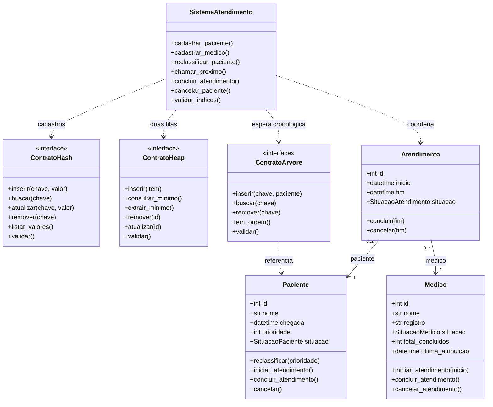

# SIGAE-09 — Arquitetura e contratos das classes

## Escopo e estado da implementação

Este documento descreve as interfaces e responsabilidades do SIGAE WEB.

- Implementados: a interface Django, as entidades `Paciente`, `Medico` e
  `Atendimento`, as três estruturas e o serviço `SistemaAtendimento`.
- Contratos: `Identificavel`, `ContratoHash`, `ContratoHeap` e `ContratoArvore`
  em `atendimentos/contratos.py` (Protocols do Python).
- A sessão fica em memória no processo Django. As operações do serviço usam uma
  trava e registram ações inversas para reverter falhas intermediárias.

Um Protocol descreve métodos e tipos para análise estática. Não implementa
algoritmos, não verifica regras de negócio em execução e não exige herança
explícita. Os testes das implementações verificam os comportamentos.

## Organização dos arquivos

| Local | Responsabilidade |
| --- | --- |
| `config/` | Configurações do Django e rotas principais |
| `atendimentos/domain/` | Entidades e validações, independentes do Django |
| `atendimentos/structures/` | Hash, Heap e Rubro-Negra implementados pela equipe |
| `atendimentos/services/` | Operações de negócio, coordenação de índices e recuperação de falhas |
| `atendimentos/contratos.py` | Interfaces das estruturas |
| `atendimentos/forms.py` | Conversão e validação das entradas web |
| `atendimentos/views.py` | Receber requisições, chamar o serviço e renderizar respostas |
| `templates/atendimentos/` | Templates centralizados |
| `css/` | Arquivos CSS centralizados na raiz |
| `atendimentos/tests/` | Testes de entidades, estruturas, integração e interface |

As views não alteram entidades ou índices diretamente. O serviço controla
as operações completas. Domínio e estruturas não importam views, formulários
ou modelos do Django. As requisições usam a mesma instância do serviço no processo.
Reiniciar o servidor cria uma sessão vazia.

## Entidades

### Paciente — implementado

Campos: `id: int`, `nome: str`, `chegada: datetime`, `prioridade: int`,
`situacao: SituacaoPaciente`.

- ID positivo, atribuído pelo serviço; unicidade conferida na Hash.
- Nome obrigatório; chegada com fuso horário; prioridade inteira de 1 a 5.
- ID e chegada não mudam enquanto o registro existir.
- `chave_chegada = (chegada em UTC, id)`.
- `chave_prioridade = (prioridade, chegada em UTC, id)`.
- `reclassificar(prioridade)` só aceita Aguardando.
- `iniciar_atendimento()`: Aguardando para Em atendimento.
- `concluir_atendimento()`: Em atendimento para Concluído.
- `cancelar()`: Aguardando ou Em atendimento para Cancelado.
- Transição inválida gera `ValueError` sem mudar a situação.

Os métodos da entidade não atualizam estruturas. O serviço deve coordená-los
com a fila, os vínculos e a recuperação de falhas.

### Medico

Campos: `id: int`, `nome: str`, `registro: str`, `situacao: SituacaoMedico`,
`total_concluidos: int`, `ultima_atribuicao: datetime | None`.

- ID automático e positivo; nome e registro fictício não vazios.
- Inicia Disponível, com zero conclusões e última atribuição `None`.
- `iniciar_atendimento(inicio)`: exige Disponível, registra a atribuição e ocupa o médico.
- `concluir_atendimento()`: exige Em atendimento, incrementa uma vez e libera.
- `cancelar_atendimento()`: exige Em atendimento e libera sem incrementar.
- Conclusão e cancelamento preservam a última atribuição.
- Tentativas inválidas geram `ValueError` sem alterar contador ou situação.

O serviço valida o atendimento associado antes de executar esses métodos,
evitando que uma solicitação antiga encerre uma consulta nova.

### Atendimento

Campos: `id: int`, `paciente: Paciente`, `medico: Medico`,
`inicio: datetime`, `fim: datetime | None`, `situacao: SituacaoAtendimento`.

- Criado pelo serviço apenas depois de selecionar paciente e médico elegíveis.
- Inicia Em atendimento; `fim` começa como `None`.
- `concluir(fim)` e `cancelar(fim)` encerram apenas um atendimento ativo.
- Encerramento deve ter fuso e não pode anteceder o início.
- Preserva referências a paciente e médico após encerrar, para histórico.
- Não incrementa contador do médico sozinho: a coordenação pertence ao serviço.

## Fonte dos registros e índices

| Estrutura | Conteúdo e propriedade |
| --- | --- |
| `TabelaHash[Paciente]` | Cadastro de todos os pacientes, inclusive encerrados |
| `ArvoreRubroNegra` | Referências aos pacientes Aguardando, por chegada e ID |
| `MinHeap[Paciente]` | Referências aos mesmos pacientes Aguardando, por urgência |
| `TabelaHash[Medico]` | Cadastro de todos os médicos |
| `MinHeap[Medico]` | Referências apenas aos médicos Disponíveis |
| `TabelaHash[Atendimento]` | Atendimentos ativos e encerrados, consultáveis por ID |
| Hash de vínculos ativos | ID do paciente para seu atendimento em andamento |
| Hash interna de cada Heap | ID do item para sua posição na lista do Heap |

Cada paciente possui uma única instância compartilhada pelos índices. Não criar
cópias independentes do paciente em cada estrutura. A mesma regra vale para médicos.
O atendimento tem ID próprio e referências às entidades existentes.

A árvore não precisa conter pacientes concluídos ou cancelados. Por isso,
a igualdade de IDs é exigida entre árvore, Heap de pacientes e subconjunto
Aguardando do cadastro, não entre todos os registros da Hash e a fila.

## Contratos das estruturas

As assinaturas oficiais estão em `atendimentos/contratos.py`.

| Interface | Operação | Resultado ou erro |
| --- | --- | --- |
| Hash | `inserir(chave, valor)` | `None`; duplicidade gera `ValueError` |
| Hash | `buscar(chave)` | Valor ou `None` se ausente |
| Hash | `atualizar(chave, valor)` | `None`; ausente gera `KeyError` |
| Hash | `remover(chave)` | Valor removido; ausente gera `KeyError` |
| Hash | `listar_valores()` | Nova lista de referências, sem ordem garantida |
| Heap | `inserir(item)` | `None`; ID duplicado gera `ValueError` |
| Heap | `consultar_minimo()` | Referência à raiz ou `None` se vazio |
| Heap | `extrair_minimo()` | Registro removido; vazio gera `IndexError` |
| Heap | `remover(id)` | Registro removido; ausente gera `KeyError` |
| Heap | `atualizar(id)` | Reorganiza após mudança da chave; ausente gera `KeyError` |
| Árvore | `inserir(chave, paciente)` | `None`; duplicidade ou chave divergente gera `ValueError` |
| Árvore | `buscar(chave)` | Paciente ou `None` se ausente |
| Árvore | `remover(chave)` | Paciente removido; ausente gera `KeyError` |
| Árvore | `em_ordem()` | Nova lista de referências em ordem crescente |
| Todas | `__len__()` | Quantidade de registros, sem percorrer toda a estrutura |
| Todas | `validar()` | `None` se válida; inconsistência gera `ValueError` |

`None` não será armazenado como valor na Hash: ele representa uma busca sem resultado.
As implementações devem rejeitar erros de entrada antes de modificar o estado.
Os métodos de listagem não permitem que alterar a lista retornada altere os nós ou
buckets internos; seus elementos continuam sendo referências às entidades.

### Configuração das implementações

- `TabelaHash(capacidade=11, fator_carga_maximo=0.75)`: capacidade positiva,
  função `id % capacidade`, encadeamento separado e redimensionamento com rehash.
  Esses valores são escolhas do projeto, não números obrigatórios do enunciado.
- `MinHeap(chave)`: recebe uma função que produz uma tupla comparável a partir
  do item. Usa lista e Hash própria de posições. A função deve ser determinística
  e não alterar o item. Trocas devem atualizar as duas posições na Hash.
- `ArvoreRubroNegra()`: inicia vazia, com sentinela NIL preta; rotações,
  recolorações e correções são detalhes internos.

Critério de pacientes: `(prioridade, chegada, id)`; menor valor vence.
Entre médicos disponíveis, compara-se primeiro o total de conclusões. Em caso
de empate, médicos sem atribuição anterior vêm primeiro. Para os demais,
compara-se o instante da última atribuição em UTC. O menor ID desempata.

### Complexidades esperadas

- Hash: consulta, atualização e remoção O(1) em média, O(n) no pior caso.
  Inserção tem custo esperado amortizado O(1); redimensionar custa O(n).
- Heap: consultar mínimo O(1); inserir/extrair/atualizar/remover reorganizam
  O(log n) posições. A Hash interna tem os custos acima; não afirmar limite
  estrito de O(log n) para o custo total em todos os casos de colisão/rehash.
- Rubro-Negra: busca, inserção e remoção O(log n); percurso completo O(n).
- Validações e geração de listagens são operações separadas e podem percorrer índices.

## Serviço central

`SistemaAtendimento` recebe/possui as Hashes, os dois heaps e a árvore.
Também controla os geradores de IDs de pacientes, médicos e atendimentos.
Os contadores são crescentes e nunca são calculados pelo tamanho das filas.

| Método | Retorno e regra |
| --- | --- |
| `cadastrar_paciente(nome, chegada, prioridade)` | `Paciente`; gera ID e inclui nos três índices apropriados |
| `buscar_paciente(id)` | `Paciente` ou `None`; consulta a Hash própria |
| `listar_fila()` | `list[Paciente]`; percurso em ordem da árvore |
| `reclassificar_paciente(id, prioridade)` | `Paciente`; modifica risco e reorganiza Heap como uma operação |
| `cadastrar_medico(nome, registro)` | `Medico`; gera ID e inclui cadastro e Heap de disponíveis |
| `buscar_medico(id)` | `Medico` ou `None` |
| `listar_medicos()` | `list[Medico]`; ordenada por ID |
| `chamar_proximo()` | `Atendimento`; indisponibilidade gera `ValueError`, preservando filas |
| `concluir_atendimento(id)` | `Atendimento` encerrado; não permite conclusão repetida |
| `cancelar_paciente(id)` | `Paciente` cancelado; se ativo, encerra vínculo e libera médico |
| `listar_atendimentos_ativos()` | `list[Atendimento]` filtrada por Em atendimento |
| `listar_historico()` | `list[Atendimento]` encerrados, ordenada por início e ID |
| `listar_chegadas()` | `list[Paciente]` de todos os estados, ordenada por chegada e ID |
| `obter_indicadores()` | Dados de pacientes por estado e totais concluídos por médico |
| `validar_indices()` | `None`; inconsistência gera `ValueError` |

Operações de alteração com ID inexistente geram `KeyError`; dados ou transições
inválidas geram `ValueError`. As views traduzem esses erros em mensagens para o
operador. Erros inesperados não podem ser apresentados como sucesso.
Os formatos de apresentação de indicadores serão definidos com o front;
não devem se tornar um cadastro paralelo que substitua os índices.

A lista cronológica histórica pode ordenar uma lista auxiliar obtida do cadastro,
com custo O(n log n), pois os encerrados não estão na árvore de espera. Esse uso
auxiliar não substitui a árvore na listagem da fila nem o Heap na chamada.

## Colaboração nas operações

### Cadastro e reclassificação

Cadastro valida, gera ID, cria um único paciente e inclui na Hash, árvore e Heap.
Reclassificação consulta a Hash, verifica Aguardando, altera a prioridade e chama
`heap.atualizar(id)`. ID e chegada permanecem iguais. O serviço deve restaurar
registro e índices se uma etapa falhar.

### Chamada

Dentro de uma operação protegida contra concorrência, verificar ambas as filas.
Selecionar o paciente prioritário e o médico elegível, remover o paciente dos
índices de espera e o médico do Heap de disponíveis, atualizar as situações e
registrar o atendimento. Sem médico, nada sai da fila. Uma falha intermediária
deve restaurar o estado anterior. A distribuição médica não altera a prioridade clínica.

### Conclusão

Buscar o atendimento pelo seu ID, exigir que esteja ativo, registrar encerramento,
concluir o paciente, incrementar uma vez o contador e liberar/reinserir o médico.
Solicitação repetida é rejeitada antes de alterar qualquer contador. Preservar
o registro de atendimento e sua associação ao médico e paciente.

### Cancelamento

Se Aguardando, retirar paciente da árvore e Heap e marcar Cancelado.
Se Em atendimento, encerrar o atendimento associado, cancelar paciente e liberar
o médico sem aumentar o contador. Preservar o histórico e a última atribuição.
Concluídos e cancelados não são encerrados novamente.

### Invariantes globais

- Árvore e Heap de pacientes contêm exatamente os pacientes Aguardando.
- Heap de médicos contém exatamente os médicos Disponíveis.
- Cada paciente/médico participa de no máximo um atendimento ativo.
- Todo atendimento ativo referencia cadastros existentes e entidades Em atendimento.
- Contadores de médicos correspondem aos atendimentos Concluídos, excluindo cancelados.
- Nenhum índice contém IDs duplicados ou referências órfãs.

## Diagrama de classes

O diagrama apresenta as entidades, as interfaces e o serviço central.
Linhas tracejadas representam dependências; linhas contínuas, associações.

Para o recorte atual, cada cadastro de paciente tem no máximo um atendimento;
retorno futuro à unidade gera novo ID de atendimento/cadastro. O diagrama usa
essa multiplicidade. Cada médico pode ter vários atendimentos históricos,
mas no máximo um ativo por vez.

## Verificação

O [relatório técnico](relatorio-tecnico.md) indica onde consultar os testes das
estruturas, das operações de atendimento e do fluxo pelo navegador.
